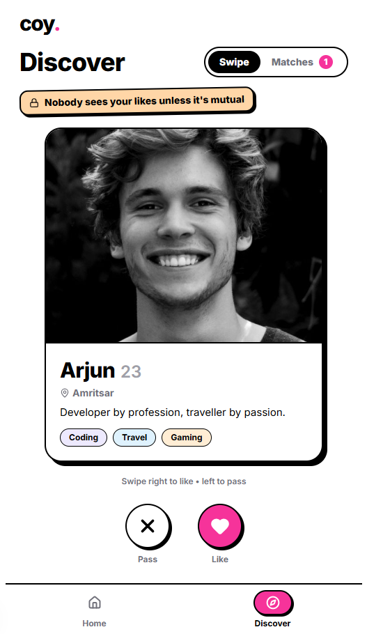
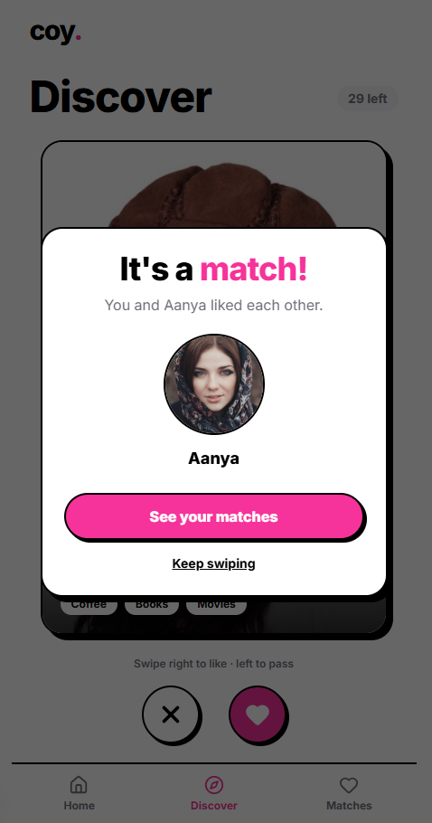
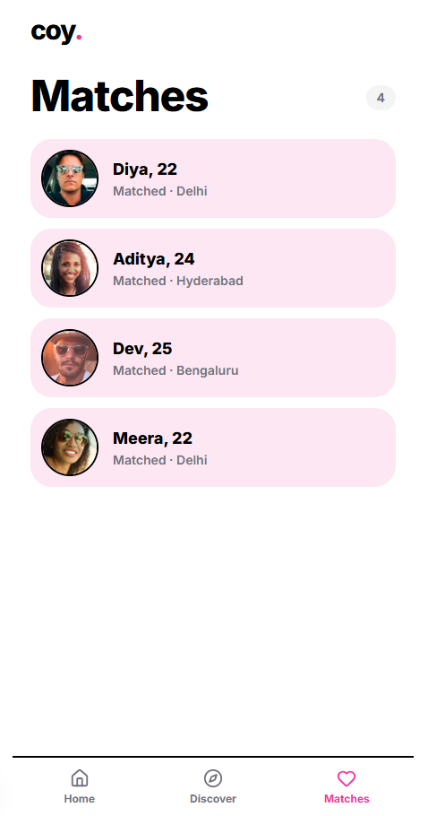
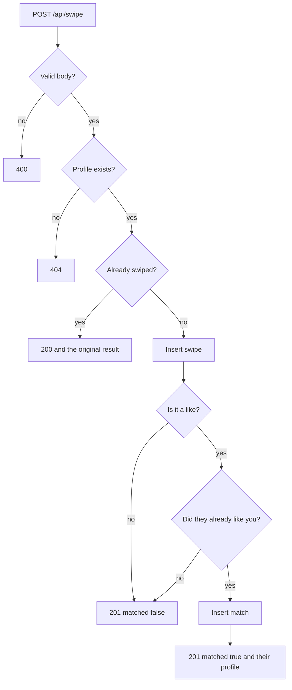

# Coy Discover

A swipe-based **Discover** tab for [Coy](https://app.getcoy.com)

Swipe right to like, left to pass. A match happens only when **both** people liked each other,
and nobody ever sees who liked them unless it is mutual.

## Demo

[https://github.com](https://github.com/user-attachments/assets/c2841939-85c8-4e1d-a091-cb6c8e7b2d1e)

| Discover | It's a match! | Matches |
|:--:|:--:|:--:|
|  |  |  |

## Features

- Tab bar with a blank **Home** placeholder, **Discover**, and **Matches**
- One profile card at a time: drag it on mobile, or use the pass and like buttons on desktop
- LIKE / PASS stamps and a fly-off animation on every swipe
- A swiped profile never comes back (enforced by the server, so it survives reloads)
- Empty state when you have seen everyone
- "It's a match!" screen at the moment a like becomes mutual
- Matches view listing every mutual match
- 30 seeded profiles; 5 of them have already liked you so you can demo a match
- Swipes and matches are stored in SQLite and persist across reloads and restarts

## Tech stack

Next.js (App Router and API routes) · React · TypeScript · Tailwind CSS · framer-motion ·
SQLite (better-sqlite3) · zod · Vitest

One app: the UI and the API live in the same Next.js project.

## Getting started

Requires Node.js 20.9 or newer.

```bash
git clone https://github.com/gurwindersingh777/coy-discover.git
cd coy-discover
npm install
npm run dev
```

Open <http://localhost:3000>. The SQLite database (`data/coy.sqlite`) is created and
seeded automatically on the first API request. It works best in a phone-sized window
(browser DevTools, device toolbar).

| Command | What it does |
|---|---|
| `npm run dev` | Development server |
| `npm run build && npm start` | Production build and server |
| `npm test` | Service and API route tests |
| `npm run typecheck` | TypeScript check |
| `npm run lint` | ESLint |
| `npm run db:reset` | Wipes all swipes and matches and re-seeds the 30 profiles |

If `npm install` fails on `better-sqlite3`, install your platform's C++ build tools and retry.

## Try the demo

The first card (Aanya) has already liked you, so swipe right on her to see **It's a match!**.
Meera, Dev, Aditya and Diya liked you too. Everyone else has not, so liking them
creates no match and reveals nothing. After 30 swipes you get the empty state; run
`npm run db:reset` to start over.

## API

The assignment's `GET /feed`, `POST /swipe` and `GET /matches` are mounted under `/api`.

| Method | Route | Description |
|---|---|---|
| GET | `/api/feed` | Profiles you have not swiped on yet |
| POST | `/api/swipe` | Records a like or pass and says whether it created a match |
| GET | `/api/matches` | Your mutual matches, newest first |

**`GET /api/feed`**

```json
{
  "success": true,
  "count": 30,
  "profiles": [
    {
      "id": "profile-001",
      "name": "Aanya",
      "age": 22,
      "photo_url": "https://i.pravatar.cc/600?img=47",
      "bio": "Love travelling, music and exploring new places.",
      "city": "Delhi",
      "interests": ["Travel", "Music", "Photography"]
    }
  ]
}
```

**`POST /api/swipe`**: body `{ "profileId": "profile-001", "action": "like" }`

```json
{ "success": true, "matched": true, "alreadySwiped": false, "match": { "id": "profile-001", "name": "Aanya" } }
```

`match` only appears when `matched` is `true`. Status codes: `201` new swipe, `200` repeated
swipe, `400` invalid body, `404` unknown profile.

**`GET /api/matches`**: same profile fields plus `matched_at`, wrapped in `{ success, count, matches }`.

## Privacy design

Who liked you is stored in the `swipes` table, but no endpoint ever returns it.

| Promise | How it is enforced |
|---|---|
| The feed never says who liked you | `/api/feed` selects only profile columns. There is no "liked you" field. |
| The feed order does not leak it either | Profiles are ordered by id, not by who liked you |
| A like is revealed only when mutual | `/api/swipe` returns a profile only after finding the reverse like |
| Matches are always mutual | `/api/matches` reads only the `matches` table, written only after a mutual like |
| No duplicate or half matches | The swipe and the match row are written in one SQLite transaction |

These rules are covered by tests.



## Design decisions

- **Service layer.** Business rules live in `src/server/services/discover.service.ts`. It takes the
  database as a parameter and knows nothing about HTTP, so tests run it on a fresh in-memory database.
  Route handlers only validate input and call the service.
- **Idempotent swipes.** Repeating a swipe (double tap, retry) returns the original result instead of
  an error, so a match is never lost.
- **One match row per pair.** Pairs are stored in sorted order with `CHECK (user_one_id < user_two_id)`
  and a `UNIQUE` constraint, so A-B and B-A can never both exist.
- **Database rules in the schema.** `UNIQUE (from, to)` on swipes, a self-swipe `CHECK`, foreign keys
  with `ON DELETE CASCADE`, and an age `CHECK (age >= 18)`.
- **Lazy, cached connection.** The database opens on the first request, never at build time, and one
  connection is reused across hot reloads.
- **Always dynamic GET routes.** The GET handlers call `connection()` so Next never prerenders them
  at build time, which would freeze the feed.

## Data model

```
users    id, name, age, photo_url, bio, city, interests (JSON), is_demo_user, created_at
swipes   id, from_user_id, to_user_id, action ('like' | 'pass'), created_at   UNIQUE (from, to)
matches  id, user_one_id, user_two_id, created_at                            UNIQUE (one, two)
```

## Testing

`npm test` runs Vitest against in-memory SQLite. It covers:

- a one-sided like never creates a match; a mutual like creates exactly one
- passing never creates a match, even on someone who liked you
- a swiped profile never returns to the feed
- repeating a swipe is safe, and a pass never turns into a like
- the feed exposes no like-related data and does not favour profiles that liked you
- the API returns the right status codes (`201`, `200`, `400`, `404`)

## Project structure

```
scripts/reset-db.ts      npm run db:reset
docs/screenshots/        images used in this README
src/app/api/             route handlers: feed, swipe, matches (HTTP only)
src/app/page.tsx         page with the tab bar
src/components/          Discover, ProfileCard, MatchModal, Matches
src/hooks/               useDiscover, useMatches
src/services/            discoverApi: typed fetch wrapper used by the hooks
src/server/services/     business rules and their tests
src/server/db/           schema, seed, connection
src/server/seed/         the 30 mock profiles
src/server/testing/      in-memory test database helper
src/tests/               API route tests
src/types/               shared types
```

## Assumptions and limitations

- One logged-in user (`demo-user`) and no auth, as the assignment allows.
- Likes are unlimited. A real product should cap them, otherwise someone could like everyone just to
  find out who liked them (Coy's crush slots solve this).
- The feed is not paginated (30 profiles).
- There is no unmatch or chat yet. In-app chat after a match is the first thing I would add.
- **Not deployed on purpose.** SQLite writes to a local file, so it needs a host with a persistent
  disk; serverless platforms do not fit. The demo video and screenshots above show the full flow.
